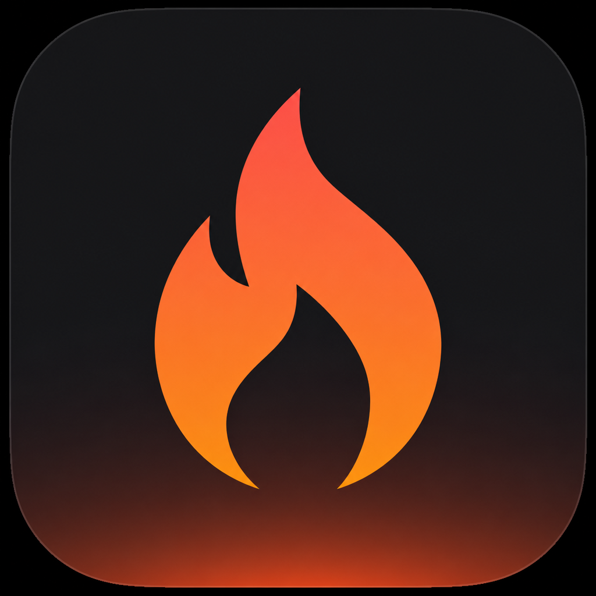

<div align="center">



# Burnrate

**See how fast you're burning Cursor spend and Claude Code usage — without opening the dashboard.**

A lightweight macOS menu bar app that shows Cursor and Claude Code usage in
real time, breaks it down by model, session, skill, and prompt, and notifies
you when it spikes. Claude Code dollars are estimates.

[](https://github.com/tomyweiss/Burnrate/releases)


[](LICENSE)

</div>

---

## Why Burnrate?

Cursor's usage dashboard lives in the browser and always feels one tab too far
away. Burnrate sits in your menu bar with a flame and a dollar amount — click
it and you get the full picture: what you spent, on which models, in which
chats, and whether you're in the middle of a spike. Claude Code is read from
transcripts already on this Mac and shown the same way, as an estimate.

- **At-a-glance total** — the selected window, in the menu bar. Claude Code is optional and shown with `~`
- **Spike alerts** — a macOS notification when a source crosses your threshold (default $10 / 10 min). Each source is checked on its own
- **Zero setup** — Cursor uses the signed-in IDE session. Claude Code is read from `~/.claude/projects`. Nothing to paste
- **Privacy-minded** — no analytics by default, no model calls that consume usage. Community stays Cursor-only and shares anonymous 24h aggregates only if you opt in. Claude Code data is never uploaded

## Install

Latest release, no Xcode. This downloads the current `Burnrate-*.zip` from
[Releases](https://github.com/tomyweiss/Burnrate/releases), installs
`Burnrate.app` to `/Applications`, and opens it:

```bash
curl -fsSL https://api.github.com/repos/tomyweiss/Burnrate/releases/latest \
  | grep -o 'https://github.com/tomyweiss/Burnrate/releases/download/[^"]*Burnrate-[^"]*\.zip' \
  | head -1 \
  | xargs curl -fL -o Burnrate.zip
unzip -o Burnrate.zip
rm -rf /Applications/Burnrate.app
mv Burnrate.app /Applications/
open /Applications/Burnrate.app
```

Or build from a clone of `main`. This compiles a release binary, installs
`Burnrate.app` to `/Applications`, and launches it:

```bash
git clone https://github.com/tomyweiss/Burnrate.git
cd Burnrate
bash scripts/package.sh --install --open
```

Side-by-side contributor build. This installs `Burnrate-dev.app` and does not
replace `/Applications/Burnrate.app`:

```bash
bash scripts/package.sh --dev --install --open
```

> [!NOTE]
> **First launch:** the app isn't Apple-notarized. If Gatekeeper blocks it,
> right-click the app → **Open**, or run:
>
> ```bash
> xattr -dr com.apple.quarantine /Applications/Burnrate.app
> open /Applications/Burnrate.app
> ```

Verify it can reach your usage data:

```bash
/Applications/Burnrate.app/Contents/MacOS/Tokens --status
# OK $12.40 today (67 events)
```

### Requirements

- macOS 26 or later
- [Cursor](https://cursor.com) signed in on this Mac, or Claude Code with at least one transcript under `~/.claude/projects`. Either source is enough. If neither is present, the panel asks you to sign in to Cursor or run Claude Code once
- Xcode 26 (or Command Line Tools with the macOS 26 SDK) to build from source

## Tour

### Menu bar

Cursor and Claude Code figures sit side by side. They are never added.

| You see | It means |
|---------|----------|
| Flame + `$12.40` | Cursor window spend for the selected timeline |
| Flame + `72%` | One included-pool percent (Cursor models or Other models) |
| Flame + `$12.40 · C 72% · O 45%` | Cursor spend plus included-pool percents. `C` is Cursor models and `O` is Other models; the letters appear only when more than one included-pool percent is on |
| Flame + `$12.40 · CC ~$31.20` | Cursor spend and estimated Claude Code spend. `CC` appears only when Cursor spend is also shown |
| Flame + `~$31.20` | Estimated Claude Code spend on its own |
| Flame + `$12.40 · 5h 62% · wk 34%` | Plan-limit percents after the other figures. `5h` is the 5-hour window and `wk` is the weekly window. Shown only when plan limits are on and those toggles are on |
| Flame alone | Every status-bar figure is off |
| Filled flame | Recent spend on any enabled source is at or above your spike threshold |
| Warning triangle | An enabled source has an error (last known amount still shown when possible) |

After an update the menu bar stays as it was. The first time Claude Code is
detected while Cursor is signed in, and Claude Code spend is still off, the
panel says "Burnrate now tracks Claude Code" with **Show in menu bar** and
**Dismiss**. When Claude Code is the only source and you have not set that
toggle, the menu bar shows `~$…`. Signing in to Cursor before you set it turns
the figure off.

### The panel

When Cursor is signed in, Claude Code data is present, and both sources are
enabled, a **Cursor | Claude Code** switcher sits at the top.
Each side shows that source's window total (`$12.40` or `~$31.20`). The rest of
the panel follows the one you pick. The two amounts are never added, and the
choice is remembered. If Cursor is not signed in, the panel opens on Claude
Code with no switcher and no Community chip.

In Cursor, the header shows the same figures you chose for the status bar (window spend
and/or included-pool percents); when only percents are on, window spend appears
on the line below. A **burn pill** shows spend in your rolling alert window
(e.g. last 10 minutes), and an hourly/daily **sparkline** shows the shape of
spend across the active window. A timeline picker switches between
**Today**, **Last 24h**, **Last 7d**, and **This billing** (configurable
billing day and timezone). The timeline is shared by both sources.

In Claude Code, every estimated dollar starts with `~`; extra usage is
Anthropic's own credit count, so it has none. Under the total: "Estimated at
API list prices · not your bill". The header shows the estimated window total,
a burn pill, and a token line. With plan limits on, 5-hour, weekly, and
per-model weekly gauges sit above that token line, plus extra usage when that
pool is on. A model with no list price shows its tokens and is
left out of the cost ("No price for <model>. Tokens shown, cost excluded").

Tabs slice the selected source:

| Tab | What it shows |
|-----|---------------|
| **Models** | Cost share per model; expand for token detail and per-session rows |
| **Sessions** | Chats across models. Cursor uses local Cursor data. A Claude Code session is one transcript; the workspace is its folder, and subagents open from the session |
| **Skills** | Cost per slash command, with total / average / median views |
| **Community** | Cursor only, from the header trophy chip. Opt-in anonymous 24h spend rank vs other sharers (share-to-view). Hidden on Claude Code |
| **Feed** | Every prompt with its attributed cost, tokens, duration, and models |
| **Bench** | Scatter chart comparing models, skills, or sessions on cost, speed, and volume — top-right is best |

### Settings

**Sources** (enable Cursor and Claude Code; **Show plan limits** is off until
you turn it on), timeline window, billing day, timezone, poll interval, spike
threshold / window / cooldown, launch at login, status-bar figures grouped
under Cursor and Claude Code, blur sensitive content (for demos and screen
shares), test notification, and updates. Spike alerts use that same threshold,
window, and cooldown for each source. A Claude Code alert is titled "Burnrate
spike · Claude Code" and says the amount is estimated.

## How it works

1. Loads your local Cursor session from the desktop app (`state.vscdb`) or Agent CLI login (`~/.cursor/auth.json` / Keychain `cursor-access-token`)
2. Polls `POST https://cursor.com/api/dashboard/get-filtered-usage-events` for events in the selected window
3. Sums Cursor's `chargedCents` for totals, sparkline buckets, models, sessions, skills, and prompts
4. Resolves chat titles and workspaces from local composer metadata when available
5. Reads Claude Code session transcripts and subagent transcripts from `~/.claude/projects`, and indexes them incrementally at `~/Library/Application Support/Burnrate/claude-index.json`. Later refreshes read only new bytes
6. Estimates Claude Code cost from those token counts and a bundled Anthropic API list-price table (input, output, cache read, and separate 5-minute and 1-hour cache-write prices)

Cursor costs are billed charges from usage events. Claude Code costs are
estimates at those list prices, shown with `~`. They are not your bill. On Pro
and Max you pay a flat rate; this is what the same usage would cost on the API.
A model with no price shows its tokens and is left out of the cost.

The first Claude Code pass shows a caption like "Indexing Claude Code · 12 of
71 sessions" while it indexes. Newest files are read first. Results appear when
that pass finishes. Until then, a menu-bar Claude Code figure reads `~$—`. Full
behavior: [CAPABILITIES.md](CAPABILITIES.md).

### Privacy & security

- Reads `cursorAuth/accessToken` from Cursor's local SQLite DB, or the Agent CLI login token, on each refresh — **never written** to Burnrate's own storage or Keychain
- When Cursor encrypts that token, Burnrate reads the "Cursor Safe Storage" Keychain password to decrypt it in memory. macOS asks once per launch unless you choose **Always Allow**; it may ask twice (app access, then team access), so choose Always Allow both times. The grant is tied to Burnrate's signing team and survives updates
- Fetches usage over HTTPS from Cursor's dashboard endpoints using that session
- Session names and workspace folders come from **local** Cursor composer metadata (and cloud agent cache for `bc-*` sessions)
- Reads `~/.claude/projects` locally (session transcripts and subagent transcripts). The index stays in Application Support. Claude Code data is never uploaded
- **Plan limits (opt-in, off by default):** reads the `Claude Code-credentials` Keychain item in memory only. Burnrate never stores that token and never refreshes it. It calls `GET https://api.anthropic.com/api/oauth/usage` at most once a minute. The request does not consume model usage. It reads the item through `/usr/bin/security`, the same tool Claude Code uses, so macOS doesn't prompt. If the token is expired or the call fails, the gauges say "Limits unavailable" and spend still works
- No analytics; no model calls that consume Cursor or Claude usage
- **Community (opt-in):** uploads anonymous rolling 24h Cursor spend + per-model costs to the Burnrate community API when you enable sharing; never session titles, prompts, Cursor identity, or any Claude Code data. Turning sharing off deletes your server row. You only see cohort data if you share. The chip is hidden when Cursor is not the selected source
- Self-updates use Sparkle (EdDSA). Auto-check is daily. Burnrate-dev does not auto-update from GitHub

## Self-updates

Production **Burnrate.app** uses [Sparkle 2](https://sparkle-project.org):

1. Checks the Sparkle appcast (`appcast.xml` on `main`) once a day
2. You confirm; Sparkle verifies the EdDSA signature and replaces the running app
3. The app relaunches

Use **Settings → Check for Updates…**. Builds are **not notarized**; if macOS
blocks a new build, right-click → Open or run `xattr -dr com.apple.quarantine`
on the app.

Burnrate-dev never auto-updates from GitHub (that would overwrite a local
contributor build with `Burnrate.app`).

**Do not commit a Sparkle private key.** Tom generates the pair with
`generate_keys` on his Mac. Clients that never installed the Sparkle bridge
release cannot jump to this tag.

Old minisign-only clients cannot update to this version — they need the
bridge GitHub Release first. [`burnrate.pub`](burnrate.pub) is kept so old
zips can still be verified by hand. Keep `burnrate.key` locally until this
tag is out; then archive it if you want.

## Limitations

- Relies on Cursor's **undocumented** dashboard API — it can change or break without notice
- Individual / personal session only (the account signed into Cursor on this Mac)
- Longer windows (7d, billing cycle) may hit the API pagination cap (~4000 events) for heavy users
- Not an official Cursor product; totals may differ slightly from the website
- Claude Code dollars are estimates at API list prices, not your Anthropic bill. Long-context price tiers are not modeled, so an estimate can differ from what the API would charge
- Claude Code deletes old transcripts. Burnrate's index keeps events it already read, so a long window does not drop them after deletion
- Not notarized for distribution outside building from source

## Development

```bash
swift build
bash scripts/package.sh --open
```

Side-by-side contributor build (does not overwrite `/Applications/Burnrate.app`):

```bash
bash scripts/package.sh --dev --install --open
# or: make install-dev
```

This installs `Burnrate-dev.app` with bundle id `com.tomyweiss.burnrate.dev`.
The menu bar keeps the normal `$` amount and adds a small gray dot next to the
flame; the panel shows an orange **DEV** badge. Self-updates are disabled.
Version defaults to the latest git tag (override with `VERSION=…`).

**Hot reload:** rebuilds and relaunches `Burnrate-dev` whenever Swift sources
change (debug build for speed). Ctrl-C stops the watcher.

```bash
make watch-dev
# or: bash scripts/dev-watch.sh
```

One-shot debug install: `bash scripts/package.sh --dev --debug --install --open`.

Package layout: Swift package target `Tokens` (internal name), shipped as **Burnrate.app**.

<details>
<summary><strong>Cutting a release (maintainers)</strong></summary>

Requires Tom's Sparkle EdDSA private key in Keychain (`generate_keys`).
`scripts/package.sh --release` should run Sparkle `sign_update` /
`generate_appcast` (see [`Release/prepare-sparkle-appcast.sh`](Release/prepare-sparkle-appcast.sh)),
not `minisign -Sm`. Do not attach `.minisig` as required for new tags.

Merge the public key into [`Resources/Sparkle.plist`](Resources/Sparkle.plist)
and inject those keys from local `scripts/package.sh`. Embed
`Sparkle.framework` with [`Release/embed-sparkle-framework.sh`](Release/embed-sparkle-framework.sh).

### One PR per release (changelog in the feature PR)

1. **Before opening your feature PR**, check the next version:

   ```bash
   bash scripts/release.sh --next-version
   # or: bash scripts/release.sh --dry-run
   ```

2. **Add a changelog section** at the top of
   `Sources/Tokens/Resources/CHANGELOG.md` in the same PR:

   ```markdown
   ## 0.0.41

   - Your user-facing change description (optional commit hash)
   ```

3. **Merge the feature PR** to `main`.

4. **Tag and publish** (no separate changelog PR):

   ```bash
   bash scripts/release.sh --yes
   ```

This tags `main`, builds, Sparkle-signs, and uploads:

- `Burnrate-x.y.z.zip`

Then commit the updated `appcast.xml`. Do not require `.minisig` on new tags.

Release notes on GitHub and in the in-app change log come from the merged
**CHANGELOG.md** section for that version.

`--dry-run` previews the next version and whether the changelog is already on
`main`. Without `--yes`, the script can still draft a changelog and open a
fallback PR if the section was not merged in the feature PR.

**Manual override** (hotfix or re-release to an existing version):

```bash
VERSION=0.0.7 bash scripts/package.sh --release
```

`VERSION=v0.0.7` works the same (leading `v` is stripped). Requires `gh` auth
and Tom's Sparkle private key in Keychain. The zip must contain `Burnrate.app`
at the top level.

</details>

## Contributing

Issues and PRs are welcome. Please keep changes focused; this is intentionally
a small menu bar utility.

## License

[MIT](LICENSE) © Tom Weiss
